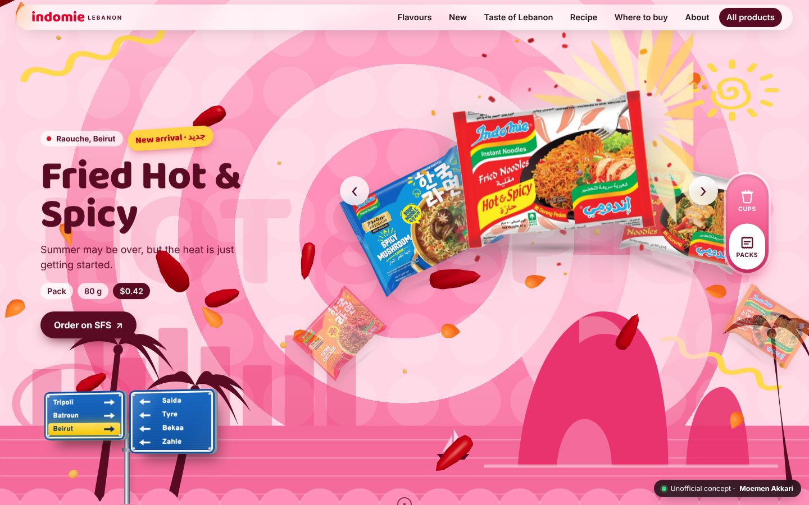
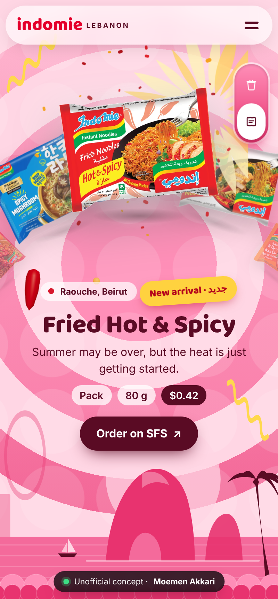
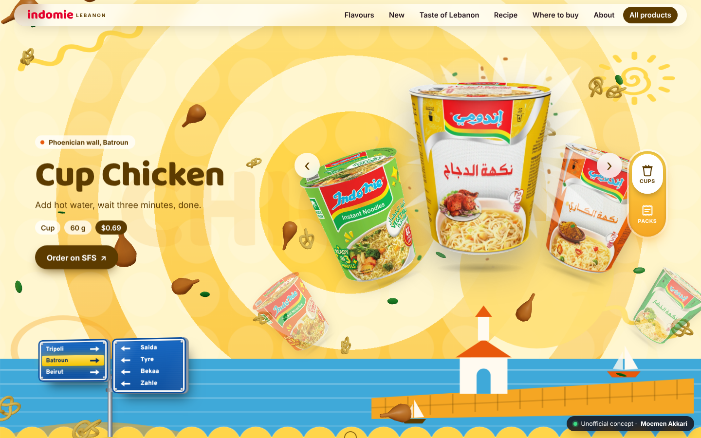

# Indomie Lebanon: Homepage Concept

> **Unofficial concept.** This is a marketing experiment for brands in the Lebanese market, and extra practice for the developer. It is not affiliated with Indomie or its distributors.
> Designed & built by [Moemen Akkari](https://www.linkedin.com/in/moemen-akari-1b94811b5/).



| Phone (400px) | Cup mode |
|---|---|
|  |  |

## What's in it
- **Flavour wallpapers.** Every flavour has its own colours (three tones, never one flat colour), a Lebanese scene drawn in SVG with pointer parallax, and real **3D ingredients** (Three.js) floating behind the product.
  | Flavour | Scene | 3D particles |
  |---|---|---|
  | Hot & Spicy | Raouche, Beirut | chillies, flames, embers |
  | Chicken | Phoenician wall, Batroun | drumsticks, herbs, noodles |
  | Vegetable | A village in South Lebanon | peas, carrot, broccoli |
  | Curry | The Citadel, Tripoli | curry leaves, chillies, spice |
  | Fried | Sea Castle, Saida | noodles, shallots |
  | Korean Fiery Chicken | Berdawni river, Zahle | flames, sesame |
  | Korean Spicy Mushroom | Baalbek, Bekaa | mushrooms, chillies |
- **Circular carousel.** Products ride a wheel. Neighbours sit lower on the circle and rise into the centre. Use swipe, tap, the arrows or ←/→.
- **Cup / Pack switch.** A vertical pill, like a phone's brightness slider. Flipping it swaps the whole catalogue and the mood.
- **Hero shine** on the active product: spotlight, sheen sweep, float, tilt and floor reflection.
- **Lebanese road sign.** The current flavour's town lights up. In *Taste of Lebanon*, tapping a sign or a map city sends the hero there.
- Sections: New arrivals (real launch dates), Taste of Lebanon, Recipe, Where to buy. Other pages show a "coming soon" note.
- **Demo mode:** `/?demo=1` auto-rotates the wheel and flips to cups once, for smooth screen recordings.

## Stack
Vite · React 18 · TypeScript (strict) · Three.js + React Three Fiber (lazy-loaded) · Framer Motion · Vitest + Testing Library · Playwright.
- `src/lib/ring.ts` holds the pure carousel maths, unit tested.
- `src/data/` holds the typed products (real SFS data) and themes.
- `src/scenes/` holds the original SVG illustrations. No stock photos, no AI images.

```bash
npm install
npm run dev            # http://localhost:5173
npm test               # unit tests
npm run build && npm run e2e   # Playwright smoke test at 400×860 and 1440×900, screenshots in shots/
npm run fetch-images   # download product photos from sfs.com.lb and cut out the white background
```

Product photos live in `public/products` (WebP cut-outs). To refresh them, run the **Fetch product photos** workflow in the Actions tab.

## Credits
Product names, prices and links come from [sfs.com.lb](https://sfs.com.lb/?s=indomie&post_type=product) (Al Sultan Food Stuff), checked 26 Oct 2026. "Order" buttons open the real SFS product page, with no fake checkout. Indomie is a trademark of its owner.
